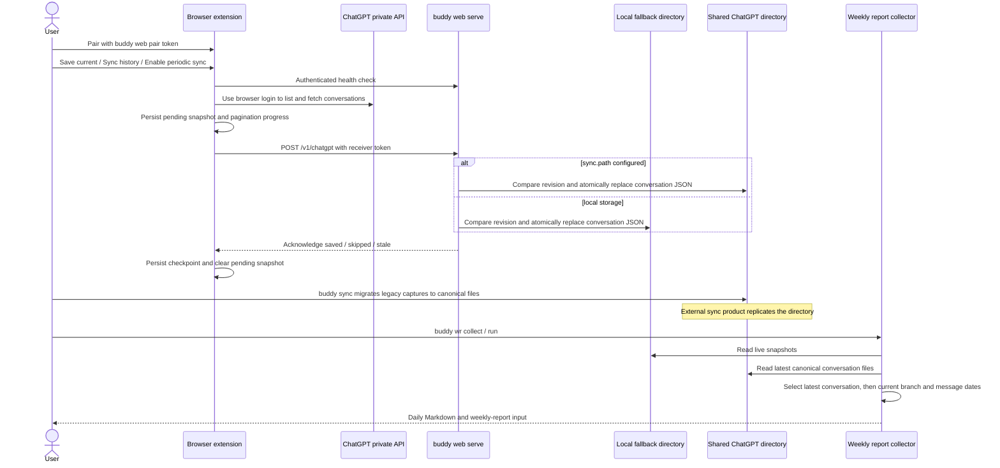

# ChatGPT web conversation sync

buddy can receive ChatGPT web conversations from a Chromium extension, archive
those snapshots across devices, and include their visible text in weekly reports.
The browser uses its existing ChatGPT login. No OpenAI API key is required.

## Setup

1. Run `buddy web serve` on the same machine as the browser. Keep this foreground
   process running; Ctrl-C stops it. The default address is `http://127.0.0.1:18242`.
2. Run `buddy web pair` in another terminal and copy its pairing token.
3. Open `chrome://extensions` (or the equivalent in Edge/Brave), enable Developer
   mode, select **Load unpacked**, and choose this repository's `extension/chatgpt`
   directory. The extension is not distributed through a browser store.
4. Open ChatGPT in that browser and sign in. Open the extension popup, paste the
   token, and select **Save and connect**.
5. Select **Save current conversation** on a saved ChatGPT conversation, or
   **Sync history** to read the paginated conversation list. Optionally enable
   **Sync every 15 minutes**.

```sh
buddy web serve
buddy web pair
buddy web status
buddy wr collect --agents chatgpt --days 7
buddy sync --agents chatgpt
```

All three `web` subcommands accept `--home`. `serve` and `status` accept `--port`;
when changing it, set the same port in the extension popup. `pair` prints a local
receiver credential: keep it private. It is separate from your ChatGPT login.
`status` prints the local conversation count and checks receiver health, failing
when the receiver is unavailable. No service installation or automatic process
startup is performed.

The receiver accepts request bodies up to 100 MiB by default. To persist a different
limit, add this section to `~/.config/buddy/config.toml`:

```toml
[web]
max_body_mib = 100
```

For a temporary override, run `buddy web serve --max-body-mib 200`. Priority is
CLI flag > config > default; values must be positive whole MiB. Configuration is
loaded from the current user's HOME, even when `--home` selects another data HOME.
Restart the receiver after changing the configuration. Its startup message shows
the effective limit. This setting limits HTTP uploads; local snapshot collection
reads saved snapshots independently of this upload limit.

## Storage and report behavior

Each account/conversation has one JSON file containing its latest complete
conversation response, schema version (`1`), and local capture time. With
`[sync].path` configured, `buddy web serve` writes directly to:

```text
<sync.path>/chatgpt/<SHA-256 account namespace>/<conversation-id>.json
```

No separate `buddy sync` is needed to publish browser captures to that directory.
Without `[sync].path`, the receiver writes to
`~/.local/share/buddy/web/chatgpt/<account>/<conversation-id>.json`. The pairing
token always stays at `~/.local/share/buddy/web/token`; it is never archived.
`--home` changes that local data/token HOME, while configuration is still loaded
from the invoking user's HOME. `web status` and receiver startup print the selected
storage directory.

New conversations create a file. Newer provider `update_time` values replace the
existing file; equal provider times use `captured_at` as a tie-breaker. Identical
conversation content is skipped and older versions are ignored. Capture time is
only a retrieval-time tie-breaker, not proof that the provider returned newer
content. Replacement writes a temporary file, syncs it, and renames it over the
canonical file. An account lock serializes comparison and publication across
receiver and sync processes on the same machine.

`buddy sync` and receiver startup migrate existing local captures, device-HOME
ChatGPT copies, and legacy `chatgpt/<account>/<conversation-id>/<hash>.json`
archives into the same canonical files. They retain the newest complete version,
then remove redundant source JSON files only after publication succeeds. Invalid
files or failed writes produce errors and keep the affected source copies for
recovery. Other providers' device archives are unchanged.

The external cloud-folder client replicates the directory; buddy performs local
filesystem operations. Use one writing device for the shared ChatGPT directory
when strict ordering is required: filesystem locks do not coordinate disconnected
cloud replicas, so concurrent writes from different devices can cause cloud-client
conflicts or replacements.

Renaming a conversation updates the same file. The account namespace is derived
from the logged-in user's ID; different accounts stay separate. No browser cookies
or provider access tokens are sent to buddy. Images and attachments are not
downloaded, and no OCR is performed.

`wr collect` and `wr run` read the canonical shared files and any remaining legacy
or local copies, selecting one latest complete conversation before filtering
message dates. `wr run` still runs `buddy sync` first when configured (unless
`--no-sync` is supplied); it never fetches ChatGPT itself. The provider update time
wins; capture time breaks ties, so obsolete copies do not resurrect old messages.
The reader follows `current_node` back through its parents and includes visible
user/assistant text from that branch only. Other branches remain in the raw JSON.
System messages, tool messages, hidden messages, and internal reasoning channels
are excluded. Dates use each message's original creation timestamp, converted to
the local timezone. Missing timestamps or broken branch references produce a
source warning instead of invented report dates.

Daily Markdown shows the ChatGPT title and original conversation URL. The source
slug is `chatgpt`, distinct from the existing `codex` coding source. Existing
message truncation and secret redaction apply. Web conversations are excluded
from `signoff` ingestion and automatic actions.

## Incremental sync and recovery

- **Sync history** compares list update timestamps with locally acknowledged
  revisions, fetching details only for changed or unrecognized conversations.
- **Recheck all history** fetches every listed conversation regardless of the
  checkpoint. Use it after restoring/deleting the local archive or if a provider
  update timestamp failed to reflect a change. Saving the current conversation
  also bypasses the checkpoint.
- A snapshot is queued in extension-local storage before delivery. The receiver
  writes through a temporary file and acknowledges only after replacing the live
  JSON file. Unchanged content is skipped and older provider revisions are ignored.
- Pagination position and per-conversation acknowledgements are scoped to the
  receiver's storage identity and survive extension worker suspension. Changing
  the storage directory starts fresh checkpoints, so a previous destination's
  acknowledgements cannot skip delivery to the new destination. A one-minute alarm checks for incomplete work even when
  periodic sync is disabled. Interrupted items may be replayed safely.
- Provider 429/5xx responses use bounded retries with backoff. Failed syncs retain
  their progress and retry after 15 minutes; the popup displays the failure.
  A failed conversation stops that run at its checkpoint. Login failures require
  signing in again. A queued snapshot for another account requires returning to
  that account before recovery can finish.
- The browser must be running for alarms to run. Closing the popup does not
  cancel synchronization. The receiver must be reachable for delivery.
- HTTP 413 means a snapshot exceeds the receiver's request size limit. Increase
  `[web] max_body_mib` or pass `--max-body-mib`, restart the receiver, and retry
  **Sync history**. The queued snapshot is retained for redelivery. A failed local
  network request also shows the upload size and identifies the Buddy receiver;
  a connection closed during an oversized upload may appear as a network failure
  rather than HTTP 413. No conversation payloads or credentials are logged.
- Deleting a provider conversation or a local source file does not delete an
  archived copy. This is a one-way archive, not a browser history restore tool.

The receiver enforces the configured request body limit and listens only on IPv4 loopback.
It validates the Host, bearer token, and any supplied Origin, and exposes no CORS
access to ordinary websites. Storage paths and filenames are constrained, symlink
storage destinations are rejected, and newly created files/directories are private
on Unix. Run one receiver per HOME. The extension requests `unlimitedStorage` for
large pending snapshots, plus storage, alarms, active-tab access, and access to
ChatGPT and the loopback receiver. Conversation data is not encrypted by buddy.

## Protocol and limitations

The extension calls ChatGPT's private session, conversation-list, and conversation
detail endpoints using the user's browser session. This approach is inspired by
[Kept's browser adapters](https://github.com/egroup-labs/kept/tree/main/extension/platforms).
It reads API responses rather than rendered page text. These private endpoints
can change or reject extension requests; login challenges may require opening
ChatGPT in the browser. Only conversations exposed by the list endpoint or an
explicit current-conversation save are captured. Temporary chats and inaccessible
or separately archived conversations are not guaranteed to appear.

The local protocol has two authenticated endpoints:

| Endpoint | Behavior |
| --- | --- |
| `GET /health` | Returns `app: "buddy"`, `schema_version: 1`, and `storage_id` (a digest identifying the storage directory) |
| `POST /v1/chatgpt` | Accepts `schema_version`, `account`, `captured_at`, and `conversation`; returns `status` (`created`, `updated`, `skipped`, or `stale`) |



## Verification

```sh
cargo test
cargo clippy
node extension/chatgpt/tests/api.test.js
node extension/chatgpt/tests/background.test.js
```

Rust integration tests exercise a real loopback receiver, authentication, atomic
updates, archival, branch filtering, latest-snapshot selection, CLI collection,
and signoff exclusion. Extension tests mock provider/receiver responses and
browser storage, including offline delivery and worker restart. They do not
replace a live test in an authenticated browser account.
